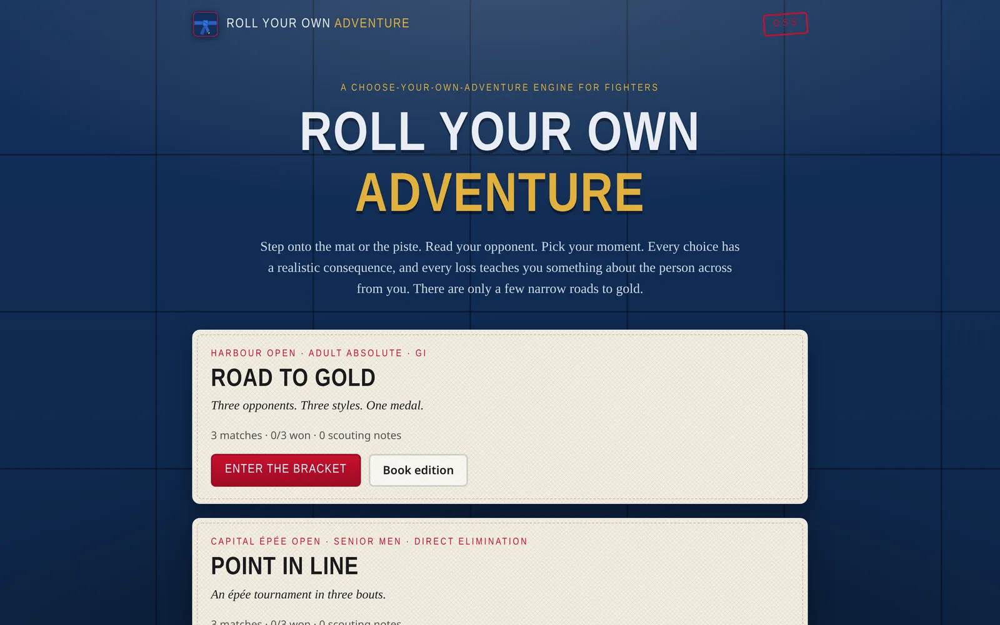
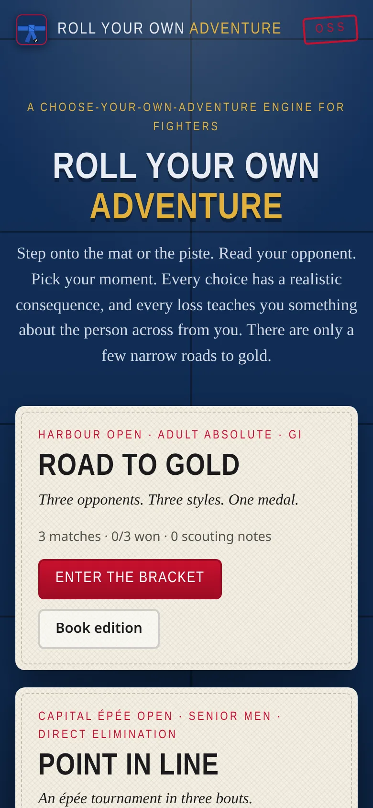

# Roll Your Own Adventure

[](https://github.com/ali-raheem/roll-your-own-adventure/actions/workflows/ci.yml) [](https://github.com/ali-raheem/roll-your-own-adventure/actions/workflows/pages.yml)

**▶ Try it live: [shoryuken.me/roll](https://shoryuken.me/roll/)** · mirror on [GitHub Pages](https://ali-raheem.github.io/roll-your-own-adventure/) · installable, works offline

<p align="center">
  <a href="https://shoryuken.me/roll/"></a>
  <a href="https://shoryuken.me/roll/"></a>
</p>

A static, offline-capable choose-your-own-adventure engine for combat sports, with two bundled
packs: **Road to Gold** (BJJ) and **Point in Line** (épée fencing).

You're a blue belt in a combined blue/purple gi absolute. Three matches stand between you and gold:

1. **Quarterfinal: Darek Nowak**, a judo 2nd dan with a blue belt. Stand with him and you get thrown.
   Get pinned in kesa gatame and you'd better know how to escape.
2. **Semifinal: Tomás Ribeiro**, a four-stripe blue with a python closed guard: collar chokes,
   triangles, omoplatas.
3. **Final: Jax Moreno**, a 10th Planet purple belt in a borrowed gi: lockdown, electric chair, the
   truck, rubber guard, and straight ankle locks.

**Point in Line** is an épée direct-elimination tournament: bouts to 15 against Henrik "The Heron"
(a two-metre left-handed counter-attacker), Luca "The Hornet" (a relentless flèche specialist) and
Aurélien "Le Professeur" (a second-intention tactician who has watched your earlier bouts).

Each loss adds to your scouting report. Codewords you learn unlock smarter options the next time you
face that opponent. The scoreboard follows each sport's rules (IBJJF-style points for BJJ; first to 15 touches, doubles and
cards for épée), and decisions are real.

## Run it

It's plain HTML/CSS/ES modules with no build step and no dependencies. Serve the folder over HTTP
(ES modules and `fetch` don't work from `file://`):

```bash
python3 -m http.server 8080      # or: npm run serve
# open http://localhost:8080
```

Deploy by copying the folder to any static host (GitHub Pages, Netlify, S3...). Once it has loaded,
a service worker caches the app and every bundled pack, so it runs offline. It can also be installed
as an app (the "Install app" button, or "Add to Home Screen" on mobile).

## Print it as a book

Every pack has a **Book edition**: numbered paragraphs, "turn to 47" choices, a scoresheet and a
codeword log. Print it or save as PDF from the browser.

## Write your own pack

Packs are markdown. See [docs/WRITING_PACKS.md](docs/WRITING_PACKS.md), then check your work:

```bash
node tools/validate.mjs          # or: npm run validate
```

## Layout

| Path | What |
|---|---|
| `index.html`, `css/style.css`, `css/sports/` | App shell, shared styles, per-sport themes |
| `js/parser.js` | Pack format parser, linting, book numbering (sport-neutral, shared with Node) |
| `js/engine.js` | Match engine: scoring, end rules, decisions, clock (shared with Node) |
| `js/sports/` | Sport modules (BJJ, épée) and shared rule helpers; see [docs/SPORTS.md](docs/SPORTS.md) |
| `js/markdown.js` | Small escaping markdown renderer |
| `js/store.js` | Pack loading, imports, progress in localStorage |
| `js/app.js` | Screens: packs, bracket, opponent intro, match, endings, podium |
| `js/book.js` | Printable gamebook renderer |
| `sw.js`, `manifest.webmanifest`, `icons/` | Offline/PWA support |
| `packs/` | Adventure packs (`index.json` lists them) |
| `tools/validate.mjs` | Pack validator (structure, plus win-rate simulation for first-to-N sports) |
| `tools/test.mjs` | Engine and sport tests (`npm test`) |

## Licence

[MIT](LICENSE) © 2026 Ali Raheem.
